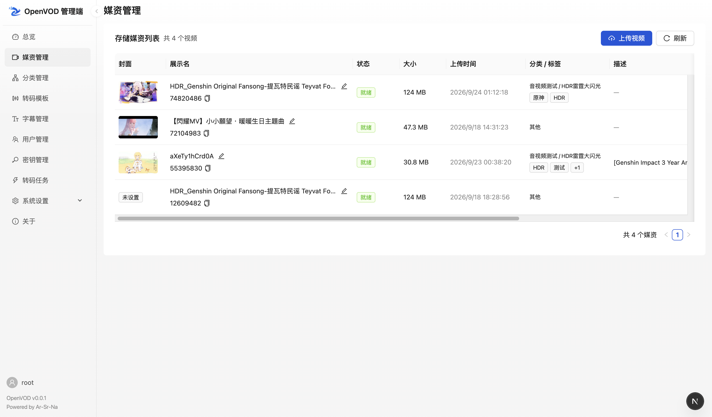
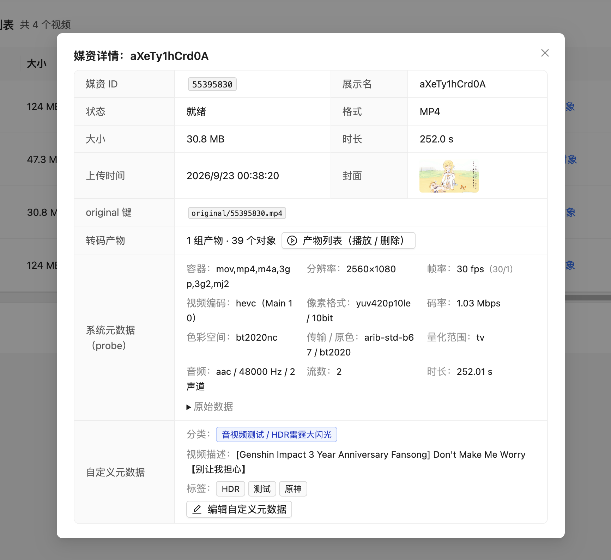
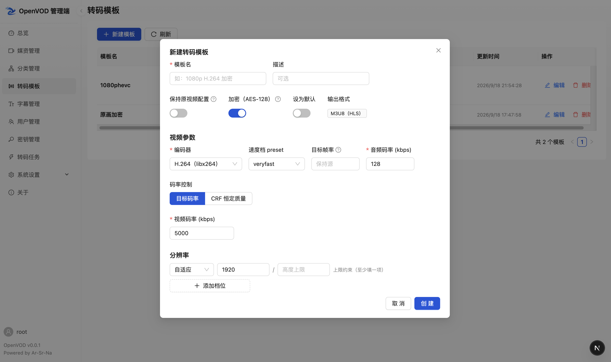

# TODO

# OpenVOD

手搓点播系统，集成媒体、分类、转码、分发、字幕管理。这是一个AI开发友好的项目。

还加入了特色，超级色的功能，媒体加密，按用户实现不同分发策略

## 媒体资产和标签管理
你可以以创作者视角，管理每一份媒体资产，获取元数据、转码、分发、字幕等信息，并以用户视角，获取媒体资产的播放地址，以及用户的播放策略。





在分类管理还可以给媒体加上标签，快速筛选资产

## 转码、加密与用户管理
提供常用的分辨率、码率、格式转码，从管理端下发任务，触发worker转码，worker可在本机部署，也可在serverless上按需触发，最好的办法当然是CNB上的强势动力。

对于HLS格式，还可以使用AES-128加密，实现分片私有化加密，防止视频被盗下载后直接播放。



## AI友好
为什么AI友好，开发所需要的文档已经全部在里面，当然不需要你全部读懂，因为这些词语太晦涩难懂，AI和AI自己构造出了一套语言系统，自顾自地在那聊正嗨呢，我们不需要插手。开发需要做的，就是准备一些`词元（token）`，以及一个强大的Agent，让AI理解下列文档，把你的需求，出现的问题，告诉你的Agent即可：

- 决策文档：[docs/vod/README.md](./docs/vod/README.md)（intent + ADR-0001 ~ 0013 + open-questions）
- 开发流程：[docs/vod/dev-workflow.md](./docs/vod/dev-workflow.md)（环境准备、启动、数据库、建号、排错）
- 管理端 Control Plane：`apps/admin`（Next.js 全栈 UI + API + better-auth + Prisma，ADR-0013）、`apps/worker`（ffmpeg 常驻容器，ADR-0008）
- 分发端 Data Plane：`apps/delivery`（Go 1.26 + Chi，EdgeOne Cloud Functions / SCF 容器）

# Reference
Readme里内容和展现方式有限，最新和最详细的文档，请查询我们的文档库：https://arsrna-it.feishu.cn/drive/folder/TY3lf4NNIlhgXKd6t2acnItMnAg?from=from_copylink

- [OpenVOD-接入指南](https://arsrna-it.feishu.cn/docx/QcxCdkqCvoPo4hx1OMvcf7yUnjf)

# 开始
由于篇幅有限，详细接入文档请参考[OpenVOD-接入指南](https://arsrna-it.feishu.cn/docx/QcxCdkqCvoPo4hx1OMvcf7yUnjf)

README内只做最简短的介绍。

## 快速试用

不想先去准备云上的 MySQL 和 S3？仓库已内置一套本地基础设施编排。在CNB云原生开发环境（或任意有Docker的机器上）一条命令把**数据库（MySQL）**和**对象存储（RustFS）**以容器拉起来。

首先Fork此项目到你的组织内，点击云原生开发即可进入开发流程。

你可以跟Agent说`启动一个体验环境`，AI会按 [docs/vod/trial-env.md](./docs/vod/trial-env.md) 的Runbook自动来帮你启动。

或者使用下列命令快速启动一个试用：

```bash
bun i                            # 安装依赖
sh scripts/compose-infra.sh up   # 起 MySQL + RustFS：自动生成凭据、等健康、建分发端受限账号
sh scripts/compose-infra.sh init-env # 生成 .env.trial（连接串指向本地 MySQL，不动根 .env）
```

已准备好：

| 组件 | 地址 | 说明 |
|---|---|---|
| MySQL 8.4 | `127.0.0.1:3306`，库 `openvod` | 业务账号 `openvod`，root 与业务口令见凭据文件 |
| RustFS（S3 API） | `http://127.0.0.1:9002` | AK/SK 随机生成；之后填进管理台 `/setup` 向导 |
| RustFS 控制台 | `http://127.0.0.1:9003` | 建桶 / 浏览对象；CNB 预览地址用 `sh scripts/compose-infra.sh url` |
| 受限账号 `openvod_ro` | 同库 | 分发端专用，脚本自动创建 |

试用的环境不包括持久化，建议开发使用下列命令开始：

```bash
task db:generate                                          # 生成 Prisma 客户端
set -a && . ./.env.trial && set +a && task db:migrate     # 建表（Prisma 从环境读连接串）
bun scripts/dev.ts --env-file .env.trial admin            # 管理台（自动带 Worker），/setup 向导的 S3 参数填 RustFS
bun scripts/dev.ts --env-file .env.trial delivery         # 分发端
```

注意事项：

- 凭据统一落在 `.run/infra.env`（权限 600，已被 gitignore）；`reset` 子命令会**删除数据卷清空数据**，`down` 保留。
- `up` 幂等可重复执行，且**全程不改根 `.env`**：连接串由 `init-env` 写进独立的 `.env.trial`（以根 `.env` 为底，仅覆盖三个 DB 键）。后续所有 `dev.ts` 命令记得带 `--env-file .env.trial`；Prisma 类命令（`task db:migrate`）不认识该文件，先 `set -a && . ./.env.trial && set +a` 导出再跑。
- 端口默认绑 `127.0.0.1`，且刻意避开了本机常驻服务（delivery `:9000`、worker http `:9001`），所以 RustFS 映射到 `9002/9003`；端口 / 镜像 / 绑定地址可用 `INFRA_*` 环境变量覆盖（见脚本头注释）。
- `.env.trial` 里的 `127.0.0.1` 连接串只对**源码直跑**（`bun scripts/dev.ts`）成立；若改用「容器形态」的 admin/worker 镜像，容器内的 `127.0.0.1` 不是宿主机，需要调整地址。
- 空库首次建表遇到 `P3014`（影子库无 `CREATE DATABASE` 权限）时，用 `env` 子命令打印的 root 连接串，或走 dev-workflow §4.3 的 baseline 流程。
- 这套编排只是**开发底座**（数据为本地 named volume）：生产请使用 TDSQL-C / 云 MySQL 与 COS 等对象存储，账号分权约定见 ADR-0011 / ADR-0015。

## 准备

> 只想先跑起来体验？见[快速试用](#快速试用)。

### 开发环境
如果你在CNB上那恭喜你，可以省去配置Node和Go环境的步骤，Fork此仓库，直接点击云原生开发即可运行

Nodejs（bun）与Go，可以在他们的官网找到对应的安装方式，或者回到上面参考接入指南

### 密钥仓库
由于云原生开发直接把密钥写在.env里面保存有泄露风险，且不适合项目迁移，所以建议使用密钥仓库，详细可在：https://docs.cnb.cool/zh/repo/secret.html 查询。

密钥仓库和`.env`格式不一样，使用的是yaml，类似这样
```yaml
key: "value"
```
而env则是
```dotenv
key=value
```
参考[环境变量](#环境变量)配置完你的变量后，在密钥仓库里新建一个文件，例如`openvod-secret.yml`，写入yml格式的环境变量，复制url，例如`https://cnb.cool/arsrna/media/openvod-secret/-/blob/main/openvod-secret.yml`，然后在`.cnb.yml`的vscode的`imports`中引入这个文件，例如本项目中
```yaml
$:
  vscode:
      ......
      imports:
        - https://cnb.cool/arsrna/media/openvod-secrets/-/blob/main/env.dev.v2.yml
```

### S3存储
为了开发方便及最大程度分离各端及保证性能，主要存储已经挪到了对象存储，下线本地存储，支持所有S3协议的对象存储，例如腾讯云COS、AWS S3、阿里云OSS、华为云OBS、Minio、RustFS等。

你需要提供（以下示例为腾讯云COS）

- 接入点 `Endpoint`，需要带上协议，例如`https://cos.ap-guangzhou.myqcloud.com`
- 地域 `Region`，例如`ap-guangzhou`
- 存储桶 `Bucket`，例如`openvod-130000000001`
- 访问密钥 `SecretId`，例如`AKID9100000000000000000000000000000000`
- 访问密钥 `SecretKey`，例如`AKID9100000000000000000000000000000000`
- 加速域名（可选），为了防止COS公有读造成的权限和安全问题，建议使用CDN后私有回源，使用加速域名还可以节省流量开支。更多请参考[接入文档](#接入文档)
- Path-Style寻址，为了兼容S3协议，部分S3不支持Path-Style，例如腾讯云是`{bucket-name}.cos.{region}.myqcloud.com`，更多请参考[接入文档](#接入文档)，Minio是`{endpoint}/{bucket-name}`，需要知道你的S3厂商支持的方式

**安全实践：访问密钥建议使用子账号，并只授予对应存储桶的读写权限**

### 数据库
目前支持sqlite与MySQL数据库，sqlite仅用于开发环境，生产环境建议使用MySQL，MySQL支持主从架构，可以实现高可用。

数据库必须能够三端访问，详情见[接入文档](#接入文档)

两种URL如下：
- MySQL：`mysql://用户名:密码@主机:端口/数据库`
- SQLite：`file:./dev.db`

## 启动开发

你可以直接与你强大的Agent说

> 请你根据开发流程文档`docs/vod/dev-workflow.md`里的说明，帮我配置完毕开发环境

AI会根据文档指引，询问你一些重要配置，例如数据库URL、初始管理员账号密码等，当然不建议从明文告诉AI，可以使用CNB密钥仓库，参考[密钥仓库配置（云原生开发）](#密钥仓库配置（云原生开发）)

如果不放心交给AI开始，也可以根据下列步骤来进行

```bash
# 安装依赖（workspaces）
bun i
# CNB 云原生开发：从密钥仓库一键生成 .env
sh scripts/gen-env.sh

# 没有密钥仓库？用问答式向导，一步步问你，回车就能配完
task env:init

# 生成Prisma客户端（mysql+sqlite两份，缺一Next无法打包）
task db:generate
# 开发库建表（SQLite）      
task db:push         
# zod → JSON Schema → Go struct（生成物入库，ADR-0001门禁）     
task contracts            
# 生成TS/Go加密互通测试向量
task vectors
# 启动服务（交互式选服务+前台/后台；日志在.run/）
bun scripts/dev.ts
```

`bun scripts/dev.ts` 是 TS 版启动器（`scripts/dev.ts`，取代旧 `./start*.sh`）：无参数时交互式勾选要启动的服务与运行方式，
也可以直接带参数；端口跟随根 `.env` 的 `ADMIN_PORT` / `DELIVERY_LISTEN`。

| 组件 | 端口 | 启动命令 |
|---|---|---|
| 管理端 admin（UI + API） | `:8787`（`ADMIN_PORT`） | `bun scripts/dev.ts admin`（**同时后台起 Worker**）或 `task dev:admin` |
| 分发端 delivery | `:9000`（`DELIVERY_LISTEN`） | `bun scripts/dev.ts delivery` 或 `task dev:delivery` |
| 转码 Worker | — | `bun scripts/dev.ts worker` 或 `task dev:worker`（需 ffmpeg / ffprobe）；起 admin 时自动一并带起 |
| 全部（后台） | — | `bun scripts/dev.ts all --background`（admin + delivery + worker），另支持 `stop`、`status`、`logs <服务>` |

## 容器形态（docker compose）

除源码直跑外，也可用预构建镜像以容器常驻运行（CNB云原生开发环境/CVM/轻量服务器）：

```bash
bun start   # 等价 sh scripts/compose.sh up：docker compose pull + up -d
```

- 启动 admin + worker 两个容器（编排见根 `docker-compose.yml`），宿主与容器端口同取 `.env` 的
  `ADMIN_PORT`；变量全部从根 `.env` 读取——compose 插值由脚本显式 source `.env`，容器内变量由
  `env_file: .env` 注入。delivery 不在编排内（ADR-0003：部署到 EdgeOne / SCF）。
- 镜像由流水线预构建（`task image:admin` / `task image:worker`，或 CNB 页面「构建admin/worker（Docker）」按钮）；
  本地已有同名镜像时，拉取失败不阻断，直接用本地镜像启动。
- 停止：`docker compose down`；其余操作：`sh scripts/compose.sh {down|ps|logs [服务]|restart [服务]|url}`。

数据库选择（SQLite / MySQL）、管理员建号、常见报错处理见
[docs/vod/dev-workflow.md](./docs/vod/dev-workflow.md)；
工具链要求见 `.ide/Dockerfile`（Bun 1.4 / Go 1.26 / ffmpeg / quicktype / Task）。

## 环境变量

项目跑起来需要一份`.env`文件，里面放着数据库地址、密钥这类配置。你不用提前搞懂每个变量是什么，两种方式生成它：

### 方式一：问答式向导（推荐新手）

```bash
task env:init
```

它会一步步问你几个问题，像聊天一样把配置做完：

1. **数据库用哪种？** —— 本地开发直接回车选`sqlite`，建个本地文件就能跑；正式部署选`mysql`
2. **密钥怎么来？** —— 直接回车选自动生成，程序帮你造一个安全的，不用管原理；管理端、转码、分发三端都认它
3. **端口保持默认吗？** —— 回车就行（管理台`8787`、分发`9000`）
4. **其他高级配置** —— 建议全部跳过，以后登录管理台，在网页里点几下就能配好

回答完毕，`.env`自动生成，文件权限收紧到只有你自己能读。已经有`.env`时会先问你"要不要覆盖"，不会悄悄丢配置。

想看每个变量的含义，可以翻`.env.example`，注释写得很全。

### 方式二：从密钥仓库一键生成（CNB 云原生开发）

如果你按上文配好了[密钥仓库](#密钥仓库配置（云原生开发）)，云原生开发打开后只需：

```bash
sh scripts/gen-env.sh
```

它会把密钥仓库注入的变量落成`.env`，全程不用回答问题。CNB 上推荐这种方式，密钥不进代码仓，换密钥也方便。

`.env`已被ignore，防止泄露，也请不要将.env提交进入任何代码仓库！！！

下面是`sh scripts/gen-env.sh`的完整用法，日常开发用不到可以跳过：

| 用法 | 说明 |
| --- | --- |
| `sh scripts/gen-env.sh` | 生成 `.env`（已存在则跳过） |
| `sh scripts/gen-env.sh --force` | 覆盖已有 `.env`（密钥轮换后用；云原生开发 stage 即用此） |
| `sh scripts/gen-env.sh --stdout` | 只打印结果不落盘（排查用） |
| `sh scripts/gen-env.sh --check` | 校验必需变量齐全且非 `.env.example` 占位值（`STRICT=1` 时非空退出 1） |
| `sh scripts/gen-env.sh -o apps/admin/.env -t .env.example` | 指定输出文件 / 模板 |

取值来源二选一（前者优先）：

1. **整体**：`OPENVOD_ENV_B64` —— 完整 `.env` 的 base64，一行搞定、不会丢特殊字符：
   ```bash
   base64 -w 0 .env                       # 本地生成（macOS: base64 -i .env）
   OPENVOD_ENV_B64=... sh scripts/gen-env.sh --force
   ```
2. **逐项**：以 `.env.example` 为模板，用同名环境变量覆盖；模板里没有的键用
   `EXTRA_ENV_KEYS` 追加（`EXTRA_ENV_KEYS=MYSQL_ROOT_PASSWORD,MYSQL_PASSWORD`）。

### 密钥仓库配置（云原生开发）

建一个「密钥仓库」（如 `arsrna/media/openvod-secrets`），Web 端新建 `env.dev.yml`：

```yaml
allow_slugs: "arsrna/media/openvod"   # 仅本项目可引用（声明任一 allow_* 则全部参与校验）
OPENVOD_ENV_B64: "RGFUQUJBU0VfVVJMPS4uLg=="
# 或逐项写法：DATABASE_URL: "..."、MASTER_KEYS: "1:<64位hex>" ...
```

`.cnb.yml` 的 vscode 流水线已接好（先 `imports` 再生成 `.env`，并让新终端自动 source）：

```yaml
imports:
  - https://cnb.cool/arsrna/media/openvod-secrets/-/blob/main/env.dev.yml
stages:
  - name: 从密钥仓库注入 .env
    script: sh scripts/gen-env.sh --force
```

要点：

- `.cnb.yml` 里 `env:` 优先级**高于** `imports`，别声明同名变量覆盖密钥。
- 轮换密钥只改密钥仓库文件，下次启动开发环境生效。
- `MASTER_KEYS` 必须 admin(TS) 与 delivery(Go) 完全一致；`URL_SIGN_KEY_HEX` 为 64 位 hex。
- 开发环境建议 `DB_PROVIDER=sqlite` + `DATABASE_URL="file:./dev.db"`（`task db:push` 建表）；
  连 MySQL / TDSQL-C 时的客户端生成、迁移与空库 baseline 流程见
  [dev-workflow §4](./docs/vod/dev-workflow.md)。
