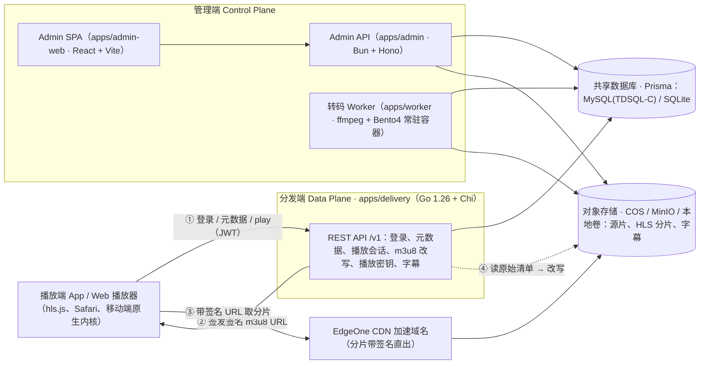

# OpenVOD — 决策文档（Decision Records）

自建云点播（VOD）系统：媒资库、转码、加密分发、元数据、WebVTT 字幕。Monorepo，双端架构，目标部署形态为腾讯云 **EdgeOne Pages** 与 **SCF（Docker 容器）**，并保留自托管 Compose 退路。

> 本目录取代早期单页文档 `vod-deploy-edgeone-scf.html`（已从工作区删除），其中经过核实的平台事实已并入 ADR-0003 与 ADR-0006。

## 架构总览

## 阅读顺序

1. [intent.md](./intent.md) — 项目意图、目标与非目标、成功标准
2. `decisions/` 按编号阅读；**ADR-0006（视频加密与播放密钥）为核心**
3. [open-questions.md](./open-questions.md) — 进入 specification 前必须关闭的问题

## 决策索引

| 编号 | 主题 | 状态 |
|---|---|---|
| [ADR-0001](./decisions/0001-monorepo-structure.md) | Monorepo 结构与工程化 | 已接受 |
| [ADR-0002](./decisions/0002-tech-stack.md) | 双端技术栈 | 已接受 |
| [ADR-0003](./decisions/0003-deployment-targets.md) | 部署目标与发布流水线 | 已接受（P0 已关闭） |
| [ADR-0004](./decisions/0004-database-and-orm.md) | 数据库与 ORM（Prisma 双方言） | 已接受 |
| [ADR-0005](./decisions/0005-storage.md) | 对象存储适配（本地 / S3） | 提议（待复核） |
| [ADR-0006](./decisions/0006-encryption-and-playback-keys.md) | 视频加密与播放密钥方案 | 已接受 |
| [ADR-0007](./decisions/0007-auth-and-users.md) | 鉴权与用户体系（JWT / 播放会话） | 已接受 |
| [ADR-0008](./decisions/0008-transcoding-pipeline.md) | 转码流水线（ffmpeg / HLS） | 提议（待复核） |
| [ADR-0009](./decisions/0009-subtitles.md) | 字幕方案（WebVTT） | 提议（待复核） |
| [ADR-0010](./decisions/0010-distribution-api-surface.md) | 分发端 API 面（v1） | 提议（待复核） |
| [ADR-0011](./decisions/0011-deployment-topology.md) | 部署拓扑：两应用共享数据面 | 已接受 |

状态语义：**已接受** = 用户已拍板，或沿用仓库既有决策（开发镜像 / 前期文档）；**提议（待复核）** = 本文档给出的推荐方案，specification 前需确认。

## 术语表

| 术语 | 含义 |
|---|---|
| 分发端 / Data Plane | 面向播放端 App 的 API + 密钥服务（Go），热路径 |
| 管理端 / Control Plane | 媒资、元数据、字幕、用户、密钥、转码管理（TS），常驻容器 |
| CEK | Content Encryption Key，每媒资随机的 AES-128 内容密钥，加密 HLS 分片 |
| MK | Master Key，主密钥，封装 CEK / JWT 私钥等敏感材料的根 |
| 播放会话（sid） | 分发端为一次点播签发的有状态会话，可吊销 |
| 签名 token | 自包含 HMAC-SHA256 短时凭证，附着在 m3u8 / 分片 / 密钥 / 字幕 URL 上 |
| ladder | 多码率转码档位组合（ABR） |
