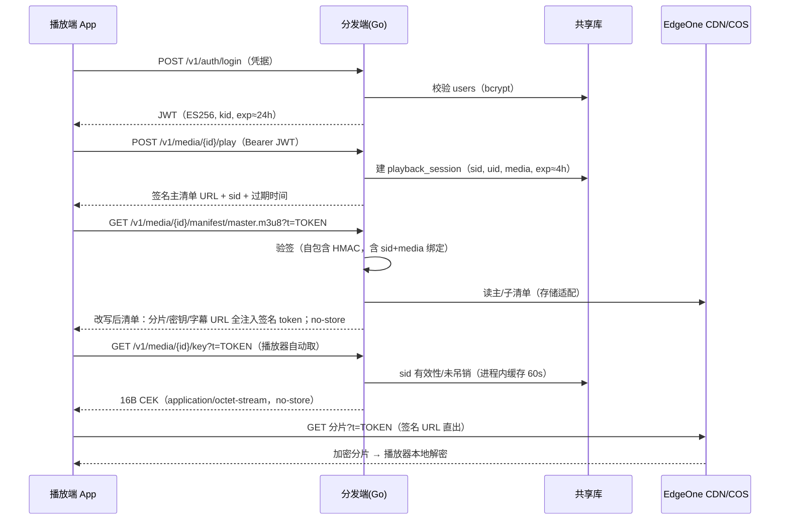

# ADR-0006：视频加密与播放密钥方案（核心）

- 状态：已接受（用户拍板：方案A；2026-09-17 经 TS vs CENC 对比后确认 **v1 采用 TS + AES-128**，CENC 作为后续升级）
- 日期：2026-09-17
- 关联：ADR-0005、ADR-0007、ADR-0010

## 背景

需求：管理端转码输出**加密 HLS**；播放密钥服务于分发端受控下发；防盗链（URL 签名）；可吊销。备选方案对比后，用户选定**方案 A：HLS AES-128 + 静态内容密钥 + 主密钥封装 + 受控密钥接口 + 全链路 URL 签名**。

hls.js 与 Safari 原生 HLS 均原生支持 `METHOD=AES-128`，无需任何 DRM 服务与证书。

## 决策

### 1. 密钥层级

```
MK（Master Key，32B，AES-256-GCM 封装根）
  │  来源：环境变量（v1）/ 腾讯云 KMS（适配器预留，open-questions #9）
  │  版本化 mk_ver；轮换 = 重封装，无需重转码
  ├──wrap→ CEK（16B AES-128，每媒资随机）—— 加密 HLS 分片（AES-128-CBC）
  ├──wrap→ JWT ES256 私钥（ADR-0007 signing_keys）
  └──wrap→ 其他敏感材料（B2B API Key 等，预留）
```

- 数据库 `hls_keys`：`media_id, kid(随机), method=AES-128, iv, wrapped_cek, mk_ver`；**明文 CEK 只存在于转码瞬间与密钥接口响应瞬间**。
- IV：每媒资转码时随机生成，显式写入清单 `EXT-X-KEY`（兼容性最好）。

### 2. 转码期（Worker）

1. 生成 CEK(16B 随机)、IV(16B 随机)、kid；
2. 写 ffmpeg `key_info` 文件（三行：密钥 URI 占位 / 本地 key 文件路径 / IV hex）：

```
https://DELIVERY_PLACEHOLDER/v1/media/{id}/key      # 转码期占位，分发时改写
/tmp/jobs/{jobId}/ceks/{kid}.key
{IV_HEX}                                            # 纯 hex、不带 0x
```

- 第三行**绝不能带 `0x` 前缀**：ffmpeg 会自行加前缀，带上会产出 `EXT-X-KEY:...IV=0x0x…` 并报 `Error setting option encryption_iv`，加密失败、分片不产出（实测 ffmpeg 6.1；`buildKeyInfoFile` 已归一化并有单测守卫，spec.md §4.2）；
- CEK 文件按 **16 字节裸字节**写入（ffmpeg 原生支持；非 2n 长度即不走 hex 解码分支）。

3. `ffmpeg -hls_key_info_file key_info -hls_time 6 -hls_playlist_type vod ...` 输出加密 TS 分片；
4. 用 MK 封装 CEK（AES-256-GCM）→ **产物上传成功之后**才连同 iv / kid / mk_ver 写入 `hls_keys`（每媒资一份：事务内先删旧行再写新行；提前落库会让失败的转码换掉旧密钥，使既有密文无法解密，spec.md §4.2）；
5. 任务结束即清理本地 key 文件与临时目录。

### 3. 播放期（分发端）



### 4. 签名 token 规范

```
token  = b64url(payload) + "." + b64url(HMAC-SHA256(signing_key, payload))
payload = ver | typ(m清单 / s分片 / k密钥 / v字幕) | mid | sid | exp | kid
```

- **自包含无状态**：热路径验签零 DB 往返；`exp` 默认与所属播放会话对齐（≤4h，可配）；
- `typ + mid` 绑定防跨媒资重放；`sid` 绑定实现一键吊销；
- 分发端自身资源（清单 / 密钥 / 字幕 / local 分片）用此 token；CDN / 存储侧分片 URL 用 **S3 预签名**（2026-09-20 修订：原定的 EdgeOne TypeA 私有回源已放弃——COS 私有桶，分发端以受限只读凭据生成预签名 GET URL，详见 ADR-0005 修订记录）。播放 URL 基址可被 `system_settings.playback_base_url` 运行时覆盖（spec.md §2.1.2）。

### 5. 缓存纪律（P0）

- m3u8（改写后）与 `/key`：`Cache-Control: no-store`，绝不进 CDN / KV / 边缘缓存；
- 分片：可 CDN 缓存（私有桶 + 签名 query）；
- CI 门禁 `assert-unsigned-403` 与 `assert-no-store`（ADR-0003）。

### 6. 轮换与吊销

| 对象 | 轮换 / 吊销方式 | 影响 |
|---|---|---|
| MK | 新增 mk_ver，后台任务重封装全部 CEK | 无需重转码 |
| CEK | 重转码（或后续做「分片重加密」离线任务） | 该媒资短时维护窗口 |
| JWT / URL 签名密钥 | kid 版本化，新旧双 key 宽限窗口 | 平滑 |
| 播放会话 | 管理端 / 分发端置 `revoked_at` | 新清单 / 密钥请求立即拒绝（验签含 sid + 会话状态缓存 ≤60s）；已下发分片在 token exp 内仍可播（接受） |

### 7. 可选强化开关（严格模式，默认关闭）

- 密钥接口一次性 nonce（KV / DB 标记，TTL 5min）—— 注意部分播放器会重取 key，需回归测试（open-questions #8）；
- IP / UA 绑定（移动网络换 IP 会断流，默认关）；
- 单用户并发播放会话上限 / 踢下线。

## 威胁模型

| 威胁 | 缓解 |
|---|---|
| 抓包拿 m3u8 / 分片 URL | 全部 URL 带签名 token；无签名 403（CI 门禁） |
| 跨媒资重放 token | token 绑定 mid + sid |
| 拿到 key URL 重放 | token 绑定 sid + 短 exp + 可吊销；严格模式可加一次性 nonce |
| 拖库拿 wrapped_cek | 无 MK 无法解封；MK 走环境 / KMS，不与库同域 |
| 分享已签名分片链接 | exp 内有效（接受）；短 exp + 会话吊销收敛 |
| 离线下载器完成播放后落盘 | **方案边界**：AES-128 静态密钥无法防已获密钥者离线解密；靠会话 / 频控 / 审计收敛，未来可选 fMP4+CENC+DRM |
| 录屏 | 无法技术防（行业共识）；水印为远期可选项 |

## 备选（否决记录）

### TS+AES-128 vs fMP4+CENC 对比（决策依据）

**前提：无 DRM license server 时，两者防护等级相同**（静态密钥 + 受控下发，持钥者均可离线解密）；差异在容器、兼容性与演进空间。

| 维度 | TS + AES-128（本方案） | fMP4 + CENC |
|---|---|---|
| 加密粒度 | 整分片 AES-128-CBC | sample 级 CTR(cbcs)，可留 clear lead |
| 播放器兼容 | 最广：Safari/iOS 原生、hls.js、ExoPlayer、TV 盒子 | 受限：hls.js 软解 CPU 开销大；Safari/iOS 原生 ≈ 必须 FairPlay（证书 + FPS server），无 DRM 原生不可用 |
| 工具链 | ffmpeg `key_info` 一条命令 | Shaka Packager / Bento4，kid/pssh/kid-map 管理复杂一档 |
| 密钥下发 | 16B 密钥 | 无 DRM 时同样下发 key（ClearKey），防护未变强 |
| 容器开销 | TS 包结构，~5–20% 码率浪费 | CMAF ~0–5%，原生 HEVC/AV1 |
| 多协议 | 仅 HLS | CMAF 一份媒体出 HLS + DASH |
| DRM 演进 | 无法接 Widevine/FairPlay，需重打包 | 即 DRM 底座，接 license server 后媒体不用重转 |

**触发迁移 CENC 的条件**：接入 DRM、带宽成本敏感（省 5–20%）、或需 HEVC。迁移 = Shaka 重打包 + 密钥表扩展，架构不变。

- **fMP4+CENC+DRM**：防破解最强，但需 license server 与证书、客户端集成，成本高；且无 DRM 时受 Safari 原生兼容限制 —— 作为演进路径保留（Shaka Packager 已在工具链，fMP4+CENC 输出可平滑切换）。
- **固定单一密钥 / 跨媒资共享密钥**：全部媒资共用一个 AES-128 密钥。一次泄露（一次 key 响应被抓、人员导出、客户端残留）即全部内容可离线解密，且无法按媒资轮换 / 吊销（重加密需要全库重转码）——**否决**；v1 坚持每媒资随机 CEK（爆炸半径限制在单个媒资，可经会话吊销 + 重转码收敛）。管理端亦不提供「查看 / 导出 / 手工指定密钥」入口。
- **仅 URL 签名不加密**：拿到链接即可拼出完整明文视频 —— 不满足需求。
- **每用户 / 每会话分片加密**：需按会话实时重加密，函数 / 边缘不可行、成本数量级上升 —— v1 否决（用会话吊销 + 短 exp 部分替代其目标）。

## 后果与风险

- 播放器兼容性最佳（hls.js / Safari / 移动端原生内核）；分发端只需 stdlib 级加解密，函数友好。
- 明文 CEK 生命周期窗口必须以代码评审 + 审计约束（specification 列为 P0 测试用例）。
- 未来切 fMP4+CENC：存储布局与密钥表已预留（method 字段），迁移 = 重打包 + 密钥表扩展，无需推翻本方案。
